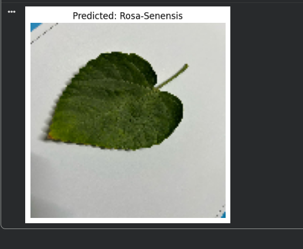

# 🌿 Leaf Species Classifier

A Convolutional Neural Network (CNN) that identifies which plant a leaf belongs to from a single image.

## Classes
- Lemon
- Mango
- Money Plant
- Rosa-sinensis (Hibiscus)
- Tulsi

## Dataset
- Collected manually (photos of leaves taken by me)
- ~5,000 images total, ~1,000 per class
- Images resized to 128 × 128 and normalized to [0, 1]
- Dataset not included in this repo due to size. 

## Model
- Framework: TensorFlow / Keras
- Architecture: CNN (___ conv layers, ___ dense layers)
- Input size: 128 × 128 × 3
- Epochs: 60
- Batch size: 32
- Split: 70% train / 30% validation
- Final training accuracy: 98%
- Final validation accuracy: 88%

## How to Run
1. Open `leaf_classifier.ipynb` in Google Colab.
2. Mount Google Drive and place the model file in your Drive.
3. Load the model:
   ```python
   model = tf.keras.models.load_model('leaf_model.h5')
   ```
4. Set `img_path` to your leaf image and run the prediction cell.

## Sample Output


## Requirements
Install dependencies with:
`pip install -r requirements.txt`
